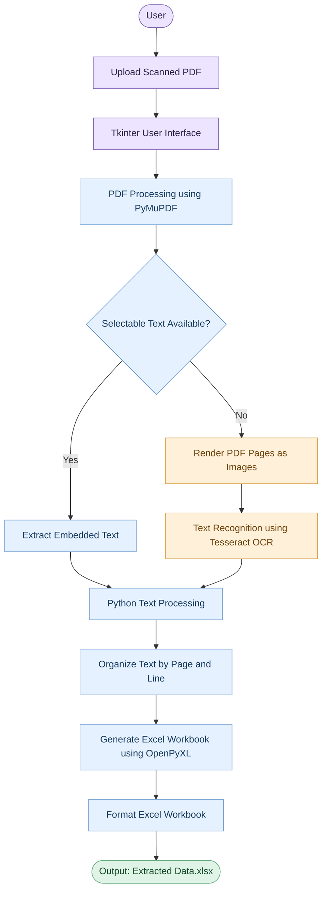

<<<<<<< HEAD
# Scanned PDF-to-Excel Application

A beginner-friendly Python desktop application that uses **PyMuPDF**, **Tesseract OCR**, and **OpenPyXL** to read scanned PDF pages and export recognized text into an editable Excel workbook. It can optionally compare extracted text with values in an existing `.xlsx` workbook.

## Features
- Select a scanned PDF using a file picker.
- Render PDF pages into images using PyMuPDF.
- Run OCR on each page with Tesseract.
- Export detected text, page number, and line number to Excel.
- Optionally compare OCR lines with cells in an existing Excel workbook.
- Save results as `.xlsx` with headings, filters, and readable column widths.

## Requirements
- Windows 10/11
- Python 3.10 or newer
- Tesseract OCR installed separately (it is an OCR engine, not a Python package)

## Setup
1. Install Python from https://www.python.org/downloads/ and enable **Add Python to PATH**.
2. Install Tesseract OCR for Windows. A common install path is:
   `C:\\Program Files\\Tesseract-OCR\\tesseract.exe`
   If installed elsewhere, add its installation folder to your Windows `PATH`.
3. Extract this ZIP file.
4. Double-click `run.bat`. It creates a virtual environment, installs Python dependencies, and starts the app.

### Run manually in VS Code
Open this folder in VS Code, then run in the terminal:

```powershell
python -m venv .venv
.\.venv\Scripts\Activate.ps1
pip install -r requirements.txt
python app.py
```

If PowerShell blocks activation, run this once in the same terminal and activate again:

```powershell
Set-ExecutionPolicy -Scope Process -ExecutionPolicy Bypass
.\.venv\Scripts\Activate.ps1
```

## How to use
1. Start the app.
2. Select a scanned PDF.
3. Choose whether to compare against an existing Excel workbook.
4. If comparing, select an `.xlsx` or `.xlsm` file.
5. Choose where to save the output `.xlsx` file.

The output workbook contains `Extracted Data` and `Run Info` sheets, plus a `Comparison` sheet when comparison is enabled.

## Important limitations
- This starter project exports recognized OCR **lines**. It does not guarantee that complex tables are reconstructed into the original rows and columns.
- OCR can misread characters, especially in low-quality scans, handwritten documents, or skewed pages. Always review the output.
- The comparison checks whether a normalized extracted line appears as a cell value in the selected workbook; it is not fuzzy matching.

## System Architecture

The application follows a step-by-step pipeline to extract text from scanned PDF documents and convert it into an Excel workbook.



### Architecture Components

1. **User Interface:** Tkinter lets users select a PDF and choose the Excel output location.
2. **PDF Processing:** PyMuPDF opens the PDF and renders scanned pages as images when necessary.
3. **Text Extraction:** Embedded text is extracted directly, or Tesseract OCR recognizes text from scanned images.
4. **Text Processing:** Python organizes the extracted text with page and line numbers.
5. **Excel Generation:** OpenPyXL creates and formats the `.xlsx` workbook.
6. **Output:** The user receives an Excel file containing the extracted text and available OCR confidence information.
